# LeMat-GenBench 模型架构画廊

来自 [LeMat-GenBench 榜单](https://huggingface.co/spaces/LeMaterial/LeMat-GenBench)的 **19 张模型架构图**，覆盖 **22 条模型记录**。点击缩略图可查看原尺寸；每张图下方附有论文链接。重复榜单条目和共用论文的模型只展示一次。

<table>
<tr>
<td align="center"><a href="paper/architecture/crystalite.png">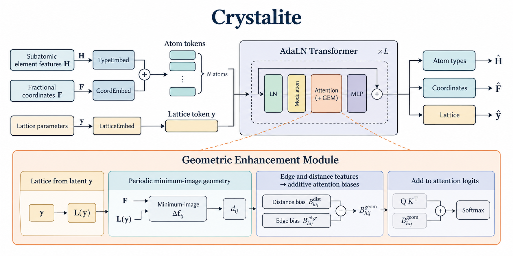 Crystalite</a></td>
<td align="center"><a href="paper/architecture/chemeleon2.png">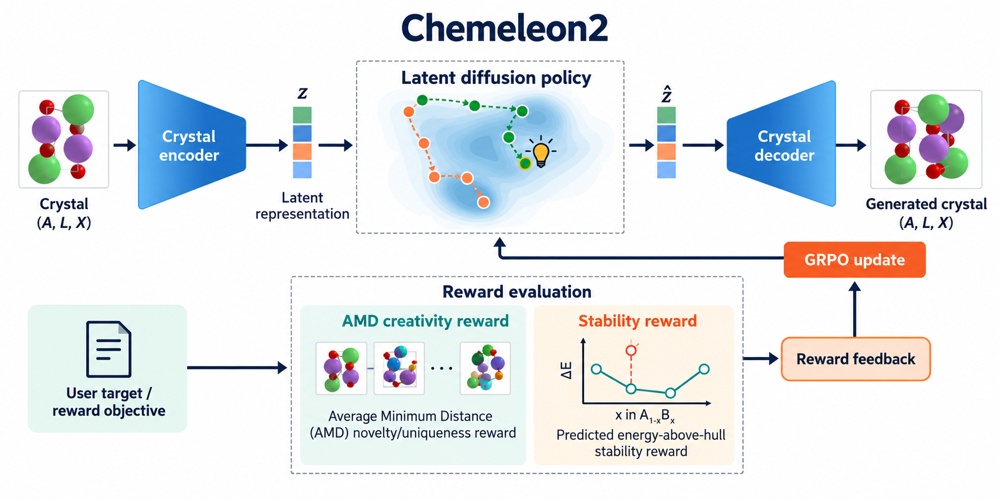 Chemeleon2</a></td>
<td align="center"><a href="paper/architecture/mcflow.png">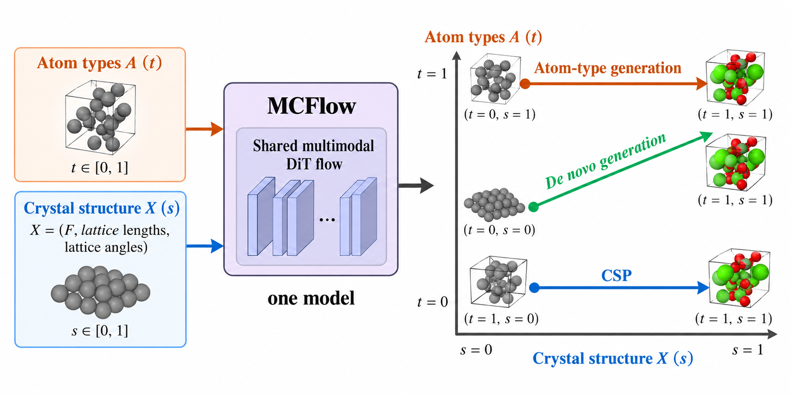 MCFlow</a></td>
<td align="center"><a href="paper/architecture/omatg.png">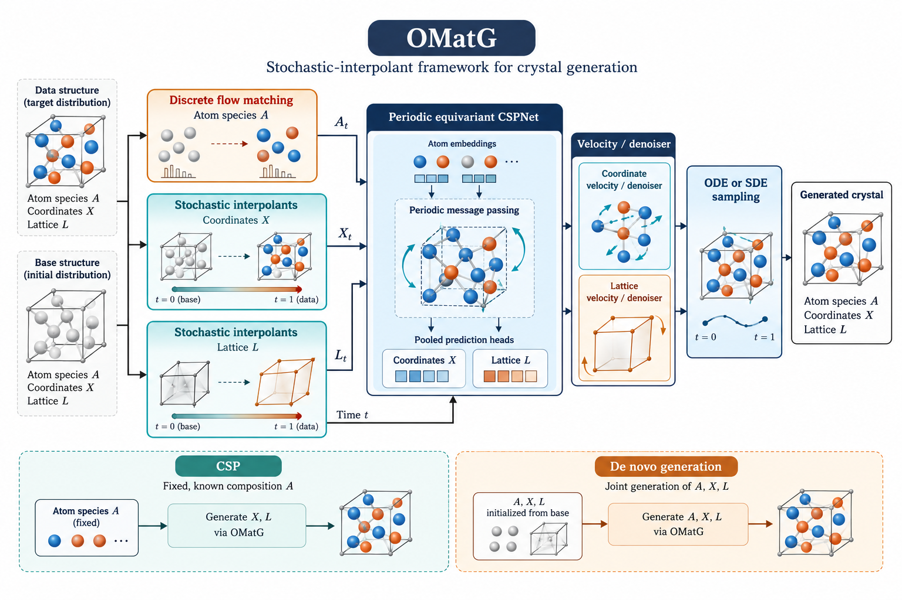 OMatG</a></td>
</tr>
<tr>
<td align="center"><a href="paper/architecture/miad.png">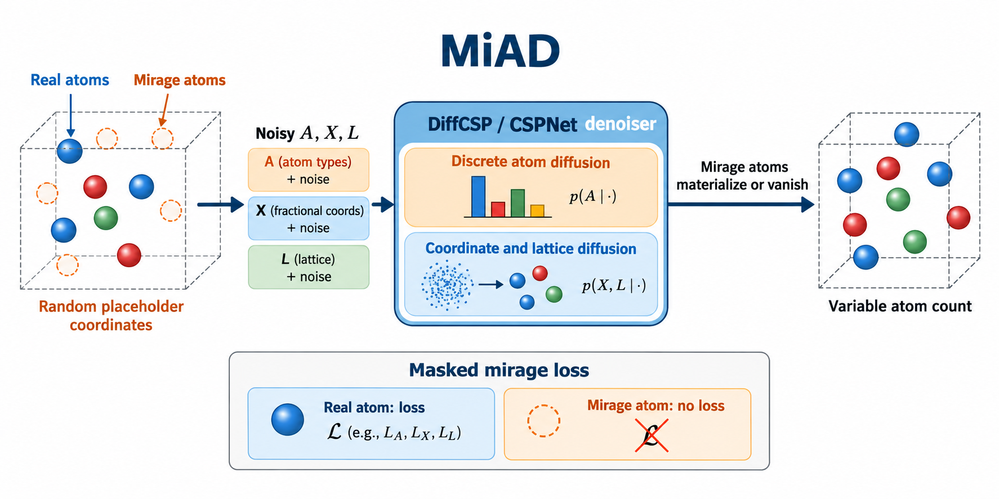 MiAD</a></td>
<td align="center"><a href="paper/architecture/mattergen.png">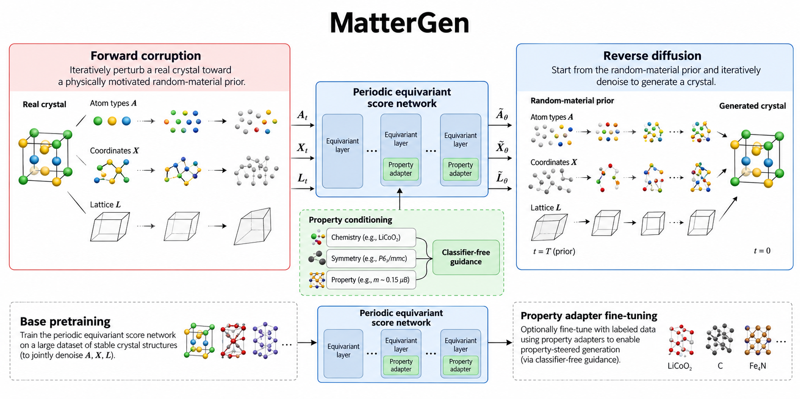 MatterGen</a></td>
<td align="center"><a href="paper/architecture/omatg_fc.png">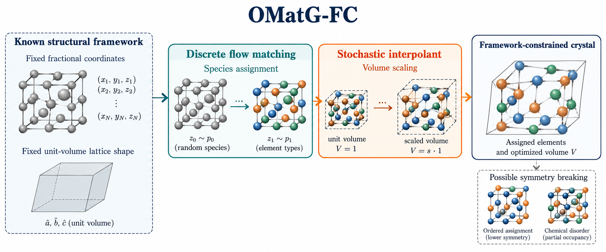 OMatG-FC</a></td>
<td align="center"><a href="paper/architecture/chemeleon1.png">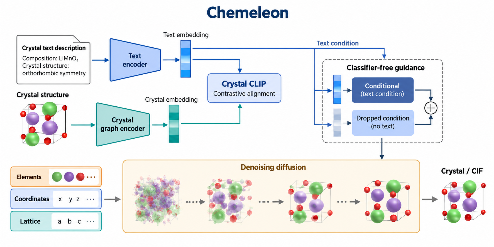 Chemeleon1</a></td>
</tr>
<tr>
<td align="center"><a href="paper/architecture/zatom.png">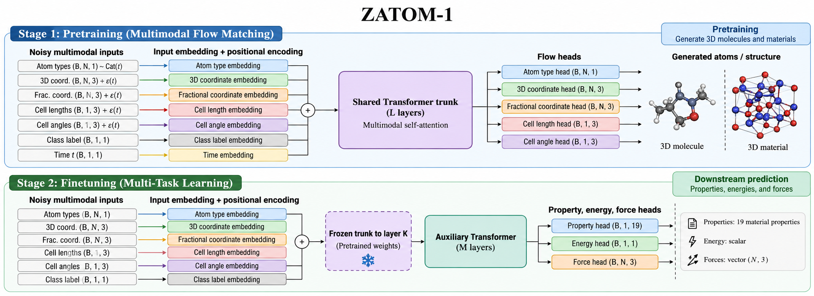 Zatom-1-WD</a></td>
<td align="center"><a href="paper/architecture/diffcsp.png">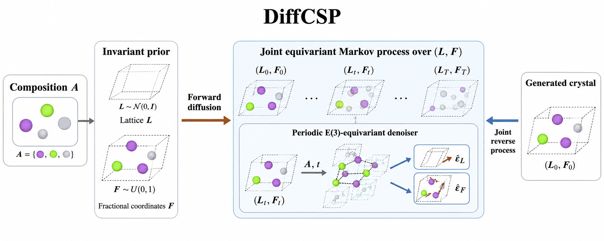 DiffCSP</a></td>
<td align="center"><a href="paper/architecture/plaidpp.png">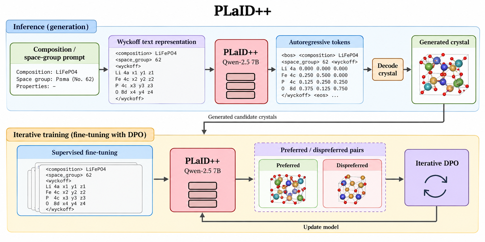 PLaID++</a></td>
<td align="center"><a href="paper/architecture/wyformer.png">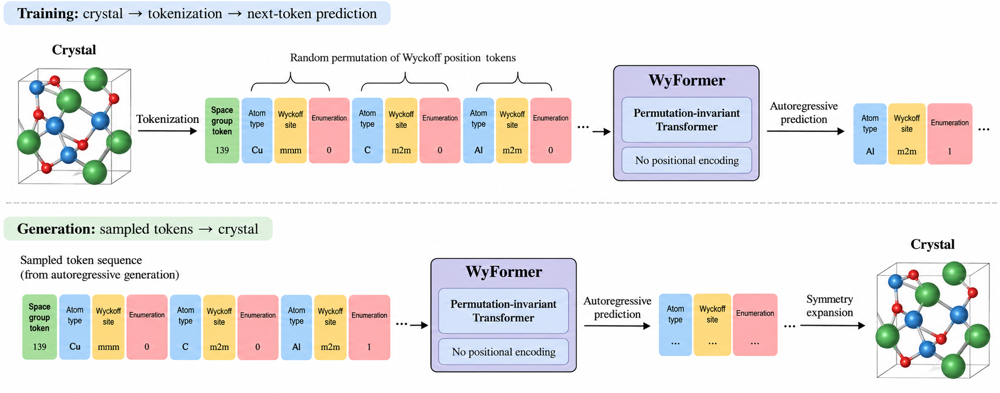 WyFormer / WyFormer-DFT</a></td>
</tr>
<tr>
<td align="center"><a href="paper/architecture/diffcsppp.png">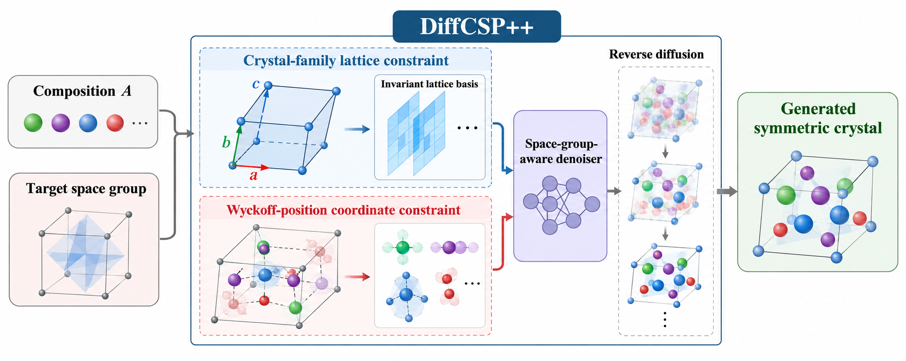 DiffCSP++</a></td>
<td align="center"><a href="paper/architecture/crystallm_pi.png">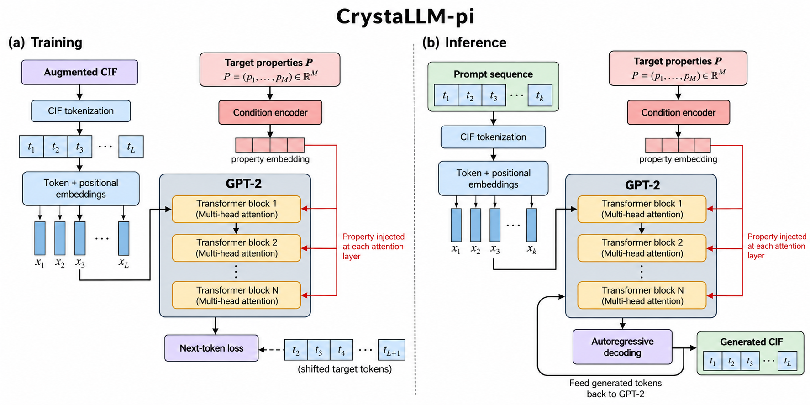 CrystaLLM-pi</a></td>
<td align="center"><a href="paper/architecture/symmcd.png">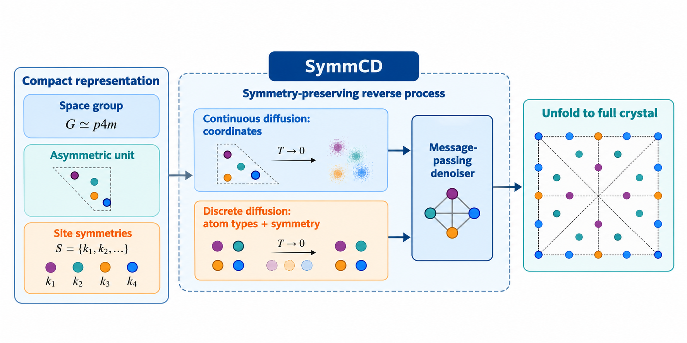 SymmCD</a></td>
<td align="center"><a href="paper/architecture/llamat.png">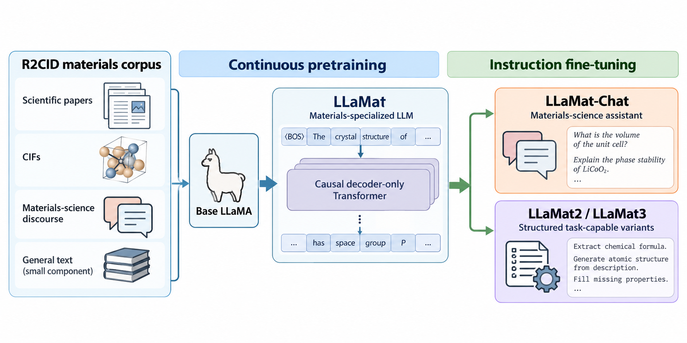 LLaMat2 / LLaMat3</a></td>
</tr>
<tr>
<td align="center"><a href="paper/architecture/crystalformer.png">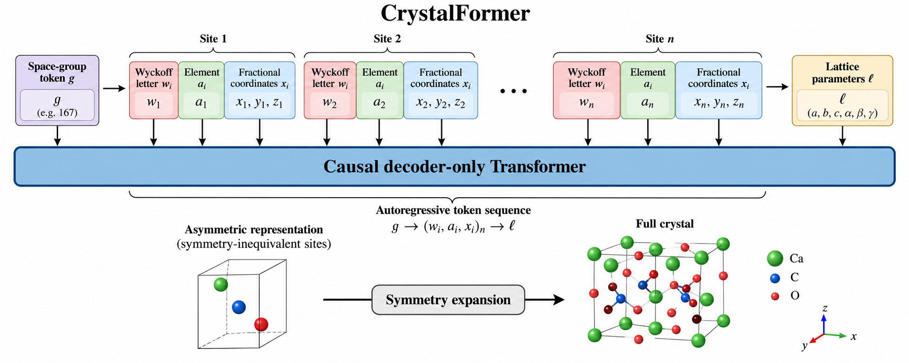 CrystalFormer</a></td>
<td align="center"><a href="paper/architecture/adit.png">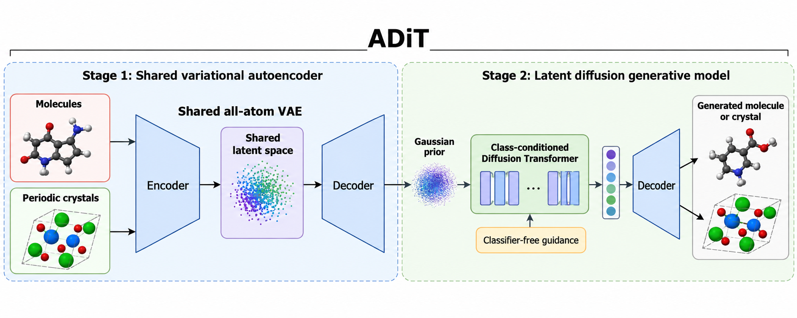 ADiT</a></td>
<td align="center"><a href="paper/architecture/crystalgfn.png">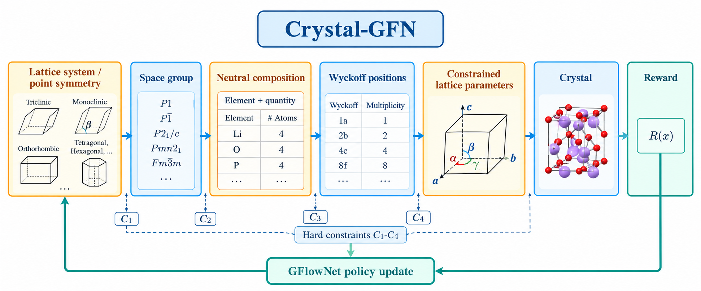 Crystal-GFN</a></td>
<td></td>
</tr>
</table>

> 架构图根据论文中的方法、图示与图注制作，是便于比较的示意图；精确实现与实验设定请以原论文为准。PDF 原文仅保存在本地，不纳入此仓库。OMatG-FC 的公开来源为 OpenReview，图据其方法描述整理。

## 架构图与论文

### Crystalite

周期几何信息进入注意力偏置，并通过条件化 Transformer 建模晶体结构。 [论文：arXiv:2604.02270](https://arxiv.org/abs/2604.02270)

### Chemeleon2

晶体潜空间扩散与奖励优化相结合，面向目标性质生成候选结构。 [论文：arXiv:2511.07158](https://arxiv.org/abs/2511.07158)

### MCFlow

在共享的多模态流模型中联合处理晶体结构与材料属性。 [论文：arXiv:2602.20210](https://arxiv.org/abs/2602.20210)

### OMatG

以连续结构流和离散原子类型演化共同生成材料。 [论文：arXiv:2502.02582](https://arxiv.org/abs/2502.02582)

### MiAD

引入占位原子来处理可变原子数的晶体生成。 [论文：arXiv:2511.14426](https://arxiv.org/abs/2511.14426)

### MatterGen

联合扩散原子类型、分数坐标与晶格，并通过适配器引入性质条件。 [论文：arXiv:2312.03687](https://arxiv.org/abs/2312.03687)

### OMatG-FC

在固定坐标与晶格形状的条件下生成原子类型和体积。 [论文：OpenReview](https://openreview.net/forum?id=Yk4FcrVcU2)

### Chemeleon1

以晶体与文本的对齐表示引导条件扩散生成。 [论文：Nature Communications](https://www.nature.com/articles/s41467-025-59636-y)

### Zatom-1-WD

多模态 Transformer 经生成式预训练后用于材料任务；榜单中的重复记录共用此图。 [论文：arXiv:2602.22251](https://arxiv.org/abs/2602.22251)

### DiffCSP

以组成作为条件，联合扩散晶格与原子分数坐标。 [论文：arXiv:2309.04475](https://arxiv.org/abs/2309.04475)

### PLaID++

将 Wyckoff 位置信息表达为序列，结合语言模型与偏好优化生成晶体。 [论文：arXiv:2509.07150](https://arxiv.org/abs/2509.07150)

### WyFormer / WyFormer-DFT

以置换不变的自回归 Transformer 生成 Wyckoff 表示；两条榜单记录共用论文。 [论文：arXiv:2503.02407](https://arxiv.org/abs/2503.02407)

### DiffCSP++

在扩散生成中加入空间群与 Wyckoff 位置约束。 [论文：arXiv:2402.03992](https://arxiv.org/abs/2402.03992)

### CrystaLLM-pi

用带性质条件的语言模型自回归生成晶体 CIF 表示。 [论文：arXiv:2511.21299](https://arxiv.org/abs/2511.21299)

### SymmCD

在非对称单元与对称操作的表示上结合离散、连续扩散。 [论文：arXiv:2502.03638](https://arxiv.org/abs/2502.03638)

### LLaMat2 / LLaMat3

材料领域继续预训练与任务微调的语言模型系列；两条榜单记录共用论文。 [论文：arXiv:2412.09560](https://arxiv.org/abs/2412.09560)

### CrystalFormer

以自回归解码器生成 Wyckoff 序列与晶格参数。 [论文：arXiv:2403.15734](https://arxiv.org/abs/2403.15734)

### ADiT

以共享变分自编码器与潜空间扩散 Transformer 处理分子和材料。 [论文：arXiv:2503.03965](https://arxiv.org/abs/2503.03965)

### Crystal-GFN

使用 GFlowNet 按对称性、组成和晶格等步骤构建晶体。 [论文：arXiv:2310.04925](https://arxiv.org/abs/2310.04925)

---

榜单中的 AFLOW、Alexandria 和 OQMD 属于参考数据库或基线，不作为生成模型绘制架构图。
